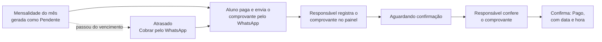
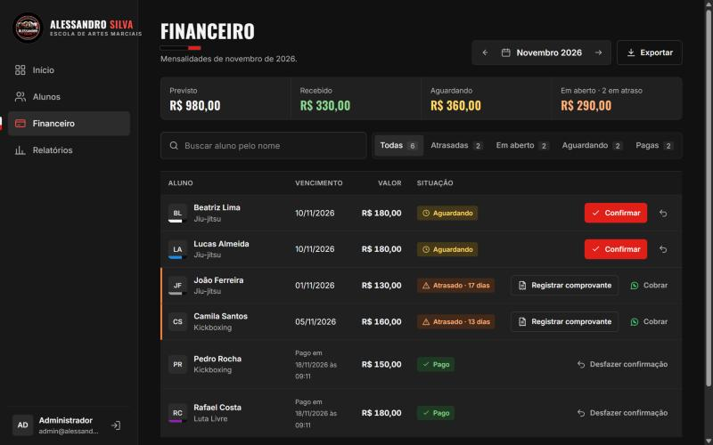
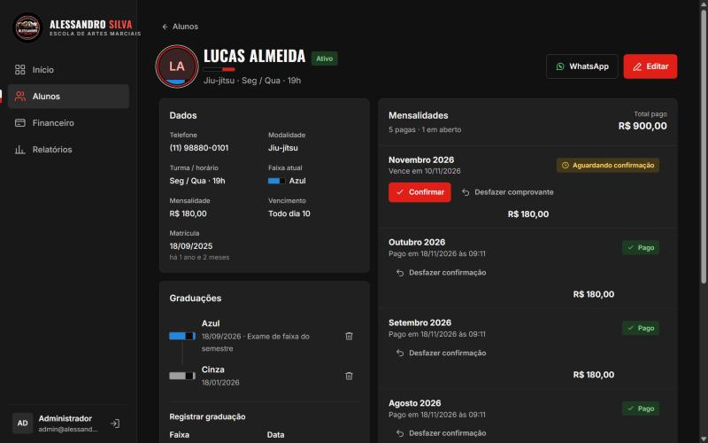
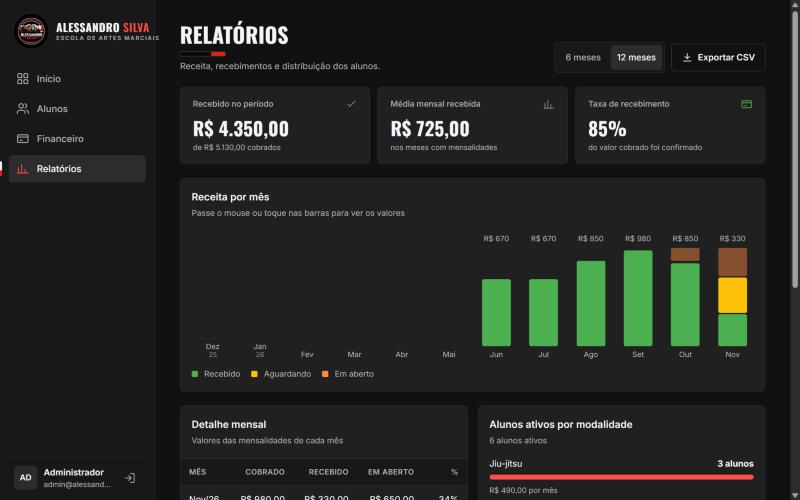
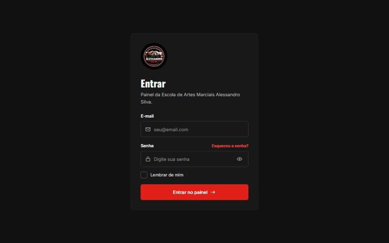
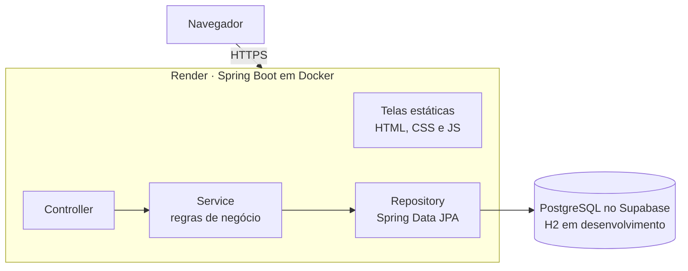

# Painel da Escola de Artes Marciais Alessandro Silva

**Acesse o sistema:** https://sistema-artesmarciais.onrender.com (acesso restrito ao administrador da escola; para
explorar, rode localmente com os [dados de demonstração](#dados-de-demonstração))

Criado em 2026 na disciplina **ACE – Desenvolvimento e Implementação de Sistemas** (Engenharia de Software –
UNIFSA), sob orientação do prof. Anderson Soares, seguindo o **Documento de Requisitos** da equipe e os protótipos
validados com a escola. A equipe está em [Equipe](#equipe).

## Sumário

- [Sobre o projeto](#sobre-o-projeto)
- [Como executar](#como-executar)
- [Dados de demonstração](#dados-de-demonstração)
- [Testes](#testes)
- [Arquitetura](#arquitetura)
- [Segurança](#segurança)
- [Deploy](#deploy)
- [Referência da API](#referência-da-api)
- [Regras de negócio e rastreabilidade](#regras-de-negócio-e-rastreabilidade)
- [Decisões sobre pontos em aberto](#decisões-sobre-pontos-em-aberto)
- [Equipe](#equipe)
- [Como continuar este projeto](#como-continuar-este-projeto)
- [Licença](#licença)

---

## Sobre o projeto

### O problema

A escola controla alunos e mensalidades de forma manual: o aluno paga, envia o comprovante pelo **WhatsApp** e a
pessoa responsável pelo financeiro confere e dá a baixa. Não há um lugar único para ver quem está ativo, quem já
pagou, quem enviou comprovante e quem está devendo.

### A solução

Um **painel administrativo pensado para o celular** que organiza essa rotina sem mudá-la. O WhatsApp continua sendo
o canal com os alunos e a conferência dos comprovantes continua sendo humana. O sistema não cobra
automaticamente; ele registra e mostra a situação de cada mensalidade.

| Rotina da escola | Módulo no painel | O que o sistema faz |
|---|---|---|
| Lista de alunos | **Alunos** | Cadastro com modalidade, turma, faixa, mensalidade, dia de vencimento e data de matrícula; busca, filtros, ordenação e exportação para planilha |
| Conferência dos comprovantes | **Financeiro** | Mensalidades do mês com status Pendente, Aguardando confirmação ou Pago; registrar comprovante, confirmar com data e hora, desfazer; atrasos destacados |
| Cobrança pelo WhatsApp | **Cobrar** | Abre o WhatsApp do aluno com a mensagem pronta (mês, valor e vencimento) |
| Trocas de faixa | **Graduações** | Histórico de graduações na ficha do aluno; a faixa atual acompanha a mais recente |
| Visão do mês | **Início e Relatórios** | Indicadores do mês, quem está aguardando conferência, quem está em atraso e receita dos últimos meses |

### Perfis de usuário

| Perfil | O que faz no sistema |
|---|---|
| **Administração / financeiro** | Único usuário do painel: cadastra alunos, registra comprovantes, confirma pagamentos, registra graduações e acompanha os indicadores |
| **Aluno** | Paga a mensalidade e envia o comprovante pelo WhatsApp. Não tem acesso ao painel nesta versão |

### Fluxo principal



Registros feitos por engano podem ser desfeitos: um comprovante volta para Pendente e uma confirmação volta para
Aguardando confirmação.

### Telas

Capturas com os dados fictícios de demonstração.

| Início | Financeiro |
|---|---|
|  |  |
| **Ficha do aluno** | **Relatórios** |
|  |  |
| **Login** | **Alunos no celular** |
|  |  |

---

## Como executar

### 1. Pré-requisitos

| Ferramenta | Versão | Como verificar |
|---|---|---|
| JDK (Java) | **21** ou mais recente | `java -version` |
| Git | qualquer | `git --version` |

Não é preciso instalar Maven nem banco de dados para testar: o projeto usa o Maven Wrapper (`mvnw`) e, em
desenvolvimento, um banco H2 em memória com dados de demonstração.

> No Windows, se faltar o Java: `winget install EclipseAdoptium.Temurin.21.JDK`. Feche e reabra o terminal
> depois de instalar.

### 2. Obter o código

```bash
git clone https://github.com/MarcusMikael/sistema-artesmarciais.git
cd sistema-artesmarciais
```

### 3. Subir o sistema

Com banco em memória e [dados de demonstração](#dados-de-demonstração):

```bash
./mvnw spring-boot:test-run
```

No Windows (PowerShell ou Prompt de Comando), use:

```powershell
.\mvnw.cmd spring-boot:test-run
```

A primeira execução baixa as dependências e leva alguns minutos. O sistema está pronto quando aparecer no log
`Started AceApplication`.

### 4. Acessar

Abra **http://localhost:8080** e entre com a conta de [demonstração](#dados-de-demonstração). O frontend é servido
pelo próprio Spring Boot, então não há um segundo servidor para subir.

### Com PostgreSQL

Para rodar com um banco de verdade, crie o banco (`CREATE DATABASE ace;`), defina as variáveis de ambiente e use
`spring-boot:run`. No PowerShell:

```powershell
$env:DB_URL="jdbc:postgresql://localhost:5432/ace"
$env:DB_USER="postgres"
$env:DB_PASSWORD="sua-senha-do-banco"
$env:ADMIN_PASSWORD="uma-senha-forte"
.\mvnw.cmd spring-boot:run
```

As tabelas são criadas automaticamente. A lista completa de variáveis está em [Deploy](#deploy).

### Recomeçar do zero

No modo de demonstração o banco fica em memória: basta parar e subir de novo para voltar aos dados iniciais.

### Problemas comuns

| Sintoma | Causa provável e solução |
|---|---|
| `java` não é reconhecido / `JAVA_HOME` inválido | JDK 21 não instalado ou fora do PATH. Instale e reabra o terminal |
| `Port 8080 was already in use` | Outro sistema já está na porta. Feche-o ou suba em outra porta: `./mvnw spring-boot:test-run -Dspring-boot.run.arguments=--server.port=8081` |
| O sistema não sobe e o log pede `ADMIN_PASSWORD` | Em produção a senha do administrador é obrigatória, com pelo menos 10 caracteres, e não pode ser a senha de demonstração |
| "Muitas tentativas de login" | 5 senhas erradas em 15 minutos bloqueiam aquele endereço. Espere o tempo indicado (localmente, reiniciar o sistema zera o contador) |
| Site publicado demora para abrir | O Render desligou o serviço por falta de uso; o primeiro acesso leva até 1 minuto (ver [Deploy](#deploy)) |
| O painel pede login de novo depois de um tempo | Marque **Lembrar de mim** no login: mantém o acesso por 30 dias, mesmo quando o Render reinicia o serviço |
| Erros de banco depois de atualizar o código | O Hibernate cria tabelas e colunas novas, mas não renomeia nem remove. Mudanças desse tipo exigem SQL manual |

### Gerar a versão de distribuição

```bash
./mvnw clean package                     # gera target/ace-0.0.1-SNAPSHOT.jar
java -jar target/ace-0.0.1-SNAPSHOT.jar  # exige as variáveis de ambiente de produção
```

---

## Dados de demonstração

Criados automaticamente no modo de demonstração (`spring-boot:test-run`, perfil `h2`). Todos os dados são
**fictícios**.

| Conta | E-mail | Senha |
|---|---|---|
| Administrador | `admin@alessandrosilva.com` | `alessandro123` |

> Essa senha existe só no modo de demonstração (`src/test/resources/application-h2.properties`). Em produção o
> sistema recusa subir com ela.

Os alunos simulam uma situação diferente cada um:

| Aluno | Modalidade | Situação nos dados |
|---|---|---|
| **Lucas Almeida** | Jiu-jítsu | Comprovante do mês aguardando conferência; graduações Cinza → Azul |
| **Beatriz Lima** | Jiu-jítsu | Comprovante do mês aguardando conferência |
| **Rafael Costa** | Luta Livre | Mês pago; graduações Azul → Roxa |
| **Pedro Rocha** | Kickboxing | Mês pago |
| **Camila Santos** | Kickboxing | Mensalidade em atraso (vence dia 5) |
| **João Ferreira** | Jiu-jítsu | Mensalidade em atraso (vence dia 1) e mês anterior em aberto; matriculado há 2 meses |
| Marina Oliveira | Luta Livre | Aluna inativa: não entra na rotina mensal |

Os cinco meses anteriores já vêm quase todos pagos, para os relatórios terem histórico.

**Como explorar o sistema:**

1. Em **Início**, veja os indicadores e clique em *Conferir* na Beatriz para confirmar o pagamento.
2. Em **Financeiro**, registre o comprovante do João e depois use *Desfazer comprovante*; use *Cobrar* na Camila
   para ver a mensagem do WhatsApp.
3. Abra a ficha do **Lucas** e registre uma nova graduação.
4. Avance o mês no **Financeiro** e use *Gerar mensalidades*.
5. Em **Relatórios**, troque entre 6 e 12 meses e exporte as planilhas.

---

## Testes

| Conjunto | Comando | O que cobre |
|---|---|---|
| **Backend** | `./mvnw test` | Regras de negócio (geração de mensalidades, vencimento e atraso, comprovante e confirmação, exclusão de aluno, reajuste, graduações, relatório de receita), segurança da API (login, bloqueio de tentativas, CSRF, cabeçalhos, validação) e "Lembrar de mim". Usa H2 em memória |

Ao final, o Maven mostra quantos testes rodaram e quantos falharam. O projeto ainda não tem integração contínua;
ver [Como continuar este projeto](#como-continuar-este-projeto).

---

## Arquitetura

Aplicação web em camadas. O Spring Boot serve a API REST e também as telas (HTML, CSS e JavaScript), então
navegador e API ficam no mesmo endereço. Só o backend acessa o banco de dados.



| Camada | Tecnologia |
|---|---|
| Backend | Java 21, Spring Boot 4.1, Spring Security (sessão + CSRF, "Lembrar de mim" com token no banco, BCrypt), Spring Data JPA / Hibernate, Bean Validation |
| Banco de dados | PostgreSQL (produção, Supabase) · H2 em memória (desenvolvimento e testes) |
| Frontend | HTML, CSS e JavaScript em módulos nativos, sem framework e sem etapa de build; fontes Inter e Oswald hospedadas no próprio sistema |
| Testes | JUnit, Spring MockMvc, AssertJ |
| Deploy | Render com Docker |

### Estrutura do repositório

```
sistema-artesmarciais/
├── pom.xml, mvnw, mvnw.cmd           Build (Maven Wrapper)
├── Dockerfile                        Imagem de produção (Render)
├── docs/imagens/                     Capturas de tela usadas neste README
├── src/main/java/ace/
│   ├── config/                       Segurança, relógio da aplicação, limite de login e "Lembrar de mim"
│   ├── controller/                   Rotas REST (/api/...) e tratamento de erros
│   ├── service/                      Regras de negócio (alunos, mensalidades, graduações, relatório)
│   ├── repository/                   Acesso a dados (Spring Data JPA)
│   ├── model/ e model/enums/         Entidades e domínios (modalidade, status do aluno e do pagamento)
│   └── dto/                          Objetos de entrada e saída da API, com validação
├── src/main/resources/
│   ├── application.properties        Configuração de produção, lida de variáveis de ambiente
│   ├── application.properties.example  Modelo de configuração local
│   └── static/
│       ├── login.html, index.html    Telas
│       ├── css/app.css               Estilos (celular primeiro; layout de computador a partir de 1280px)
│       ├── js/common.js              Ícones e chamadas à API (usado também pelo login)
│       ├── js/app/                   Rotas, estado, componentes e formatação
│       ├── js/app/views/             Uma tela por arquivo (início, alunos, ficha, cadastro, financeiro, relatórios)
│       └── fonts/, img/              Fontes e logomarca
└── src/test/                         Testes e dados de demonstração (perfil h2)
```

### Parâmetros configuráveis

| Propriedade | Padrão | Uso |
|---|---|---|
| `app.timezone` | `America/Sao_Paulo` | Fuso das datas de vencimento e de confirmação |
| `app.login.max-falhas-por-ip` | 5 | Senhas erradas que bloqueiam um endereço |
| `app.login.max-falhas-por-conta` | 20 | Senhas erradas, de qualquer endereço, que bloqueiam a conta |
| `app.login.janela-minutos` / `bloqueio-minutos` | 15 / 15 | Janela de contagem e duração do bloqueio |
| `server.servlet.session.timeout` | 8h | Duração da sessão sem "Lembrar de mim" |

O dia de vencimento padrão (10) fica em `AlunoModel.DIA_VENCIMENTO_PADRAO`, e a validade do "Lembrar de mim"
(30 dias), em `SecurityConfig`.

---

## Segurança

**Acesso.** Um único administrador, definido pelas variáveis `ADMIN_EMAIL` e `ADMIN_PASSWORD`. O sistema não sobe
sem a senha, nem com menos de 10 caracteres, nem com a senha de demonstração.

**Sessão.** Cookie de sessão `HttpOnly` e `SameSite=Lax`, `Secure` atrás do HTTPS do Render.

**Lembrar de mim.** Mantém o acesso por 30 dias no mesmo navegador. O token fica no banco (tabela
`login_lembrado`), por isso continua valendo quando o Render reinicia o serviço. Ele é trocado a cada uso, o que
permite detectar um cookie copiado, e é apagado ao sair do painel.

**Esqueceu a senha?** A senha é a variável `ADMIN_PASSWORD` no Render: para redefinir, troque o valor e refaça o
deploy. A tela de login orienta a procurar o responsável técnico.

**Limite de tentativas de login.** 5 senhas erradas em 15 minutos bloqueiam aquele endereço por 15 minutos; 20
erradas, de qualquer endereço, bloqueiam a conta pelo mesmo tempo. Os contadores ficam em memória.

**CSRF.** Toda alteração exige o cabeçalho `X-XSRF-TOKEN` com o valor do cookie `XSRF-TOKEN`, que o frontend envia
sempre e um site de terceiros não consegue ler.

**Cabeçalhos HTTP.** Content-Security-Policy restrita ao próprio site (sem scripts de terceiros), `X-Frame-Options:
DENY`, `nosniff`, `Referrer-Policy` e `Permissions-Policy`. Respostas de erro não mostram detalhes internos.

**Dados.** Consultas parametrizadas (Spring Data JPA); todo texto exibido nas telas passa por escape; exportações
CSV neutralizam fórmulas do Excel.

---

## Deploy

### Render (Docker)

O `Dockerfile` gera a imagem de produção em duas etapas (Maven e JRE 21). As dependências ficam numa camada
própria, para não serem baixadas de novo quando só o código muda. A aplicação roda sem privilégios de root e com a
JVM ajustada para o plano gratuito (512 MB e pouca CPU). Variáveis de ambiente:

| Variável | Obrigatória | Exemplo / descrição |
|---|---|---|
| `DB_URL` | sim | `jdbc:postgresql://host:5432/postgres?sslmode=require` |
| `DB_USER` / `DB_PASSWORD` | sim | credenciais do banco |
| `ADMIN_PASSWORD` | sim | senha do administrador, com 10 ou mais caracteres (sem ela o sistema não sobe) |
| `ADMIN_EMAIL` | não | e-mail de login; padrão `admin@alessandrosilva.com` |
| `ADMIN_NOME` | não | nome exibido no painel; padrão `Administrador` |
| `APP_TIMEZONE` | não | padrão `America/Sao_Paulo` |
| `REMEMBER_ME_KEY` | não | chave do "Lembrar de mim"; padrão: o e-mail do administrador |
| `JPA_SHOW_SQL` | não | `true` para ver as consultas SQL no log |
| `JAVA_TOOL_OPTIONS` | não | substitui os ajustes padrão da JVM definidos no `Dockerfile` |

O Render define a porta pela variável `PORT`, que o sistema já lê.

### Fuso horário

O Render roda em UTC, 3 horas à frente de Brasília. Por isso as datas usam o relógio da aplicação
(`ClockConfig`, fuso `app.timezone`): sem isso, a hora da confirmação sairia adiantada e, entre 21h e
meia-noite, o sistema consideraria o dia seguinte nos vencimentos.

### Primeiro acesso lento (Render gratuito)

No plano gratuito, o Render desliga o serviço depois de cerca de 15 minutos sem uso, e o próximo acesso leva de 30
segundos a 1 minuto. O deploy também é lento, porque o build roda com pouca CPU. Para eliminar a espera, use uma
instância paga ou, perto de apresentações, um serviço de ping gratuito chamando o endereço do sistema a cada 10
minutos.

### Banco de dados em produção

- **Conexão segura:** o `DB_URL` deve terminar com `?sslmode=require`.
- **Backup:** antes de apresentações e de mudanças grandes, gere uma cópia com `pg_dump`:

  ```bash
  pg_dump "URL_DO_BANCO" --no-owner --format=custom --file=ace-backup.dump
  ```

  Para restaurar em um banco novo: `pg_restore --no-owner --dbname "URL_DO_BANCO_NOVO" ace-backup.dump`.
- **Esquema:** o Hibernate atualiza as tabelas sozinho (`ddl-auto=update`): cria tabelas e colunas novas, mas nunca
  apaga nem altera colunas existentes. Se o projeto continuar, o próximo passo é adotar migrações versionadas
  (Flyway).

---

## Referência da API

Todas as rotas ficam em `/api` e exigem login, exceto `POST /api/auth/login` e `GET /api/auth/csrf`. Alterações
(POST, PUT, PATCH e DELETE) exigem o cabeçalho `X-XSRF-TOKEN`.

Os erros seguem a estrutura `{message, fields}`:

| Código | Significado |
|---|---|
| 400 | validação (`fields` traz o erro de cada campo) ou parâmetro inválido |
| 401 | não autenticado |
| 403 | token CSRF ausente |
| 404 | não encontrado |
| 409 | regra de negócio ou registro em conflito |
| 429 | muitas tentativas de login |

| Recurso | Principais operações |
|---|---|
| `/api/auth` | `login` (formulário: `email`, `senha`, `lembrar`), `logout`, `me`, `csrf` |
| `/api/alunos` | listar, buscar por id, cadastrar, editar, excluir; `/buscar?nome=`, `/status/{status}`, `/{id}/pagamentos` (histórico) |
| `/api/alunos/{id}/graduacoes` | listar, registrar, `DELETE /{idGraduacao}` |
| `/api/pagamentos` | `/mes?mes=&ano=`, `/status/{status}`, `/gerar?mes=&ano=`, criar avulso; `PATCH /{id}/comprovante`, `/desfazer-comprovante`, `/confirmar`, `/desfazer-confirmacao` |
| `/api/relatorios` | `/receita?meses=12` (receita mês a mês) |

---

## Regras de negócio e rastreabilidade

| Requisito do documento | Onde está implementado |
|---|---|
| RF01 cadastrar, editar e excluir alunos | `AlunoController`, `AlunoService` |
| RF02 buscar por nome e filtrar por status | `views/students.js` (busca e filtros); `GET /api/alunos/buscar` e `/status/{status}` |
| RF03 status de pagamento mês a mês | `PagamentoService.listarPorMesAno` e `gerarMensalidades`; `views/finance.js` |
| RF04 marcar comprovante recebido | `PagamentoService.registrarComprovante` |
| RF05 confirmar com data e hora | `PagamentoService.confirmarPagamento` (relógio no fuso da escola) |
| RF06 desfazer confirmação | `PagamentoService.desfazerConfirmacao` |
| RF07 filtrar por status | `views/finance.js` (`filteredPayments`) |
| RF08 painel de indicadores | `views/dashboard.js` |
| RNF01 confortável no celular | `css/app.css` (celular primeiro, alvos de toque de 44px, campos de 16px) |
| RNF02 financeiro manual | nenhuma cobrança automática; *Cobrar* só abre o WhatsApp |
| RNF03 sem controle de frequência | não implementado de propósito |
| RNF04 comunicação pelo WhatsApp | `format.js` (`whatsappLink`, `mensagemCobranca`) |
| RN01 só alunos ativos na rotina mensal | `PagamentoService.gerarMensalidades` (`findByStatus(ATIVO)`) |
| RN02 referência de mês e ano | colunas obrigatórias em `PagamentoModel`; `validarReferencia`; `UNIQUE(aluno, mês, ano)` |
| RN03 três status | `StatusPagamento` (PENDENTE, AGUARDANDO_CONFIRMACAO, PAGO) |
| RN04 Aguardando ao registrar comprovante | `PagamentoService.registrarComprovante` |
| RN05 Pago só após conferência manual | `confirmarPagamento` exige comprovante; a tela pede "Conferi o comprovante" |
| RN06 data e hora da confirmação | `PagamentoModel.dataHoraConfirmacao` |
| RN07 desfazer confirmação | `PagamentoService.desfazerConfirmacao` |
| RN08 não confirmados identificáveis | Financeiro e Início mostram pendentes, atrasados e aguardando (`state.js`, `pagamentosDoMes`) |
| RN09 comprovante fora do sistema | o painel só registra; não há envio de arquivos |
| RN10 só Jiu-jítsu, Luta Livre e Kickboxing | `Modalidade` (a API recusa outros valores) |

Regras complementares adotadas para manter os dados consistentes:

- aluno com comprovante registrado ou pagamento confirmado não pode ser excluído, só inativado (`AlunoService.excluir`);
- meses anteriores à matrícula não são cobrados (`gerarMensalidades`);
- mudanças de valor ou de dia de vencimento valem só para as mensalidades ainda pendentes (`AlunoService.atualizar`);
- o valor fica gravado em cada mensalidade, então reajustes não alteram pagamentos já conferidos;
- registrar uma graduação atualiza a faixa atual do aluno (vale a mais recente) (`GraduacaoService`).

---

## Decisões sobre pontos em aberto

Pontos que o documento de requisitos não definia, resolvidos com os padrões abaixo. **Precisam ser validados com a
escola ou com o professor.**

| Ponto | Decisão adotada | Onde mudar |
|---|---|---|
| Onde guardar os dados | O documento previa dados no navegador; adotamos PostgreSQL, o que também permite usar o painel em mais de um aparelho | `application.properties` |
| Geração das mensalidades | Automática para o mês atual; manual (botão) para outros meses | `state.js` (`loadPagamentos`) |
| Vencimento | Cada aluno tem um dia de 1 a 28 (padrão 10); pendente após o vencimento aparece como atrasado | `AlunoModel`, `PagamentoResponse` |
| Exclusão de aluno | Bloqueada quando há histórico financeiro; o caminho é inativar | `AlunoService.excluir` |
| Alunos inativos no financeiro | Aparecem só se a mensalidade já tiver comprovante ou estiver paga | `state.js` (`pagamentosDoMes`) |
| Comprovante registrado por engano | Pode voltar para Pendente | `PagamentoService.desfazerComprovante` |
| Usuários do sistema | Um único administrador, definido por variáveis de ambiente; sem cadastro de usuários | `SecurityConfig` |
| Recuperação de senha | Sem envio de e-mail: a senha é redefinida no servidor (Render) | `login.html` |
| Funções além do documento | Graduações, relatórios, cobrança pelo WhatsApp e exportação CSV, que não contrariam o escopo | — |

---

## Equipe

| Campo | Informação |
|---|---|
| **Período letivo** | 2026 |
| **Turma** | 6º período |
| **Disciplina** | ACE – Desenvolvimento e Implementação de Sistemas |
| **Curso e instituição** | Engenharia de Software – UNIFSA, Teresina – PI |
| **Orientação** | Prof. Anderson Soares |

| Integrante |
|---|
| Antônio Neves Aguiar Neto |
| Marcus Mikael Rodrigues Vieira |
| Marcos André dos Santos Soares |
| João Pedro Lima Barbosa |

---

## Como continuar este projeto

1. **Copie o repositório.** Prefira o botão *Fork* do GitHub, que mantém o vínculo com o original.
2. **Registre a sua equipe** na seção [Equipe](#equipe), com período letivo, turma, disciplina e orientação.
3. **Rode o projeto localmente** seguindo [Como executar](#como-executar) e confira os [testes](#testes).
4. **Publique a sua versão**, se for o caso, com uma conta própria no Render e um banco PostgreSQL próprio
   ([Deploy](#deploy)): defina uma `ADMIN_PASSWORD` nova e atualize o link do sistema no topo deste README.
5. **Revise os pontos em aberto** ([Decisões sobre pontos em aberto](#decisões-sobre-pontos-em-aberto)) com a escola
   antes de mudar regras.
6. **Próximos passos sugeridos:** integração contínua no GitHub Actions rodando `./mvnw test` em cada pull request;
   migrações versionadas com Flyway; cadastro de usuários com recuperação de senha por e-mail.
7. **Mantenha a documentação em dia:** se o visual mudar, refaça as capturas em `docs/imagens/`.

---

## Licença

O repositório ainda não define uma licença. Até que uma seja escolhida e o arquivo `LICENSE` seja adicionado, o
código não pode ser reutilizado por terceiros sem autorização da equipe.
