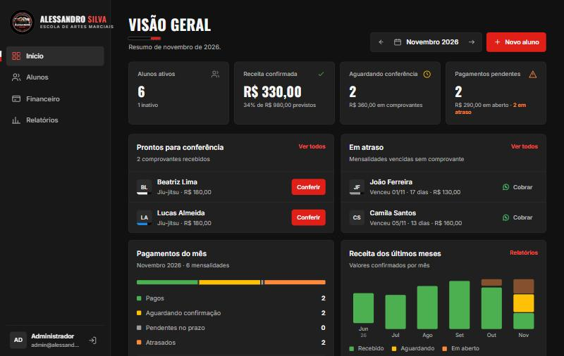

# Painel da Escola de Artes Marciais Alessandro Silva

**Acesse o sistema:** https://sistema-artesmarciais.onrender.com (acesso restrito ao administrador da escola)

Painel administrativo para organizar o cadastro de alunos e o acompanhamento manual das mensalidades de uma escola
de artes marciais (Jiu-Jitsu, Luta livre e Kickboxing). Criado em 2026.2 na disciplina **ACE – Desenvolvimento e
Implementação de Sistemas** (Engenharia de Software – UNIFSA), sob orientação do prof. Anderson Soares.

## Sobre o projeto

Na escola, o aluno paga a mensalidade, envia o comprovante pelo **WhatsApp** e o responsável confere e dá a baixa.
O painel organiza essa rotina sem mudá-la: o WhatsApp continua sendo o canal com os alunos, a conferência continua
manual e não há cobrança automática.

- **Alunos:** cadastro com modalidade, turma, faixa, mensalidade e dia de vencimento; busca, filtros e exportação
  para planilha.
- **Financeiro:** mensalidades do mês com status Pendente, Aguardando confirmação ou Pago; registrar comprovante,
  confirmar com data e hora e desfazer; atrasos destacados e cobrança pelo WhatsApp com mensagem pronta.
- **Ficha do aluno:** histórico de mensalidades e de graduações (trocas de faixa).
- **Início e Relatórios:** indicadores do mês e receita dos últimos meses.

Funciona no celular e no computador.

| Início | Financeiro |
|---|---|
|  |  |

No celular:

| Início | Alunos | Financeiro | Ficha do aluno |
|---|---|---|---|
|  |  |  |  |

## Como executar

Requisito: **Java 21**. O Maven vem junto no projeto.

```bash
git clone https://github.com/MarcusMikael/sistema-artesmarciais.git
cd sistema-artesmarciais
./mvnw spring-boot:test-run
```

No Windows, use `.\mvnw.cmd spring-boot:test-run`. Abra **http://localhost:8080** e entre com
`admin@alessandrosilva.com` / `alessandro123`. Esse modo usa um banco em memória com alunos fictícios de exemplo,
que somem ao reiniciar; a senha de exemplo não é aceita em produção.

Para rodar os testes automatizados: `./mvnw test`.

## Tecnologias

- **Backend:** Java 21, Spring Boot 4 (Web, Data JPA, Security, Validation)
- **Frontend:** HTML, CSS e JavaScript, servidos pelo próprio Spring Boot
- **Banco:** PostgreSQL (Supabase) em produção; H2 em memória para desenvolvimento e testes
- **Deploy:** Docker no Render

## Deploy

O `Dockerfile` gera a imagem publicada no Render. Variáveis de ambiente obrigatórias:

| Variável | Descrição |
|---|---|
| `DB_URL` | endereço do PostgreSQL, terminando com `?sslmode=require` |
| `DB_USER` / `DB_PASSWORD` | credenciais do banco |
| `ADMIN_PASSWORD` | senha do administrador, com pelo menos 10 caracteres |

Opcionais: `ADMIN_EMAIL` (padrão `admin@alessandrosilva.com`), `ADMIN_NOME` e `APP_TIMEZONE` (padrão
`America/Sao_Paulo`). Para redefinir a senha do painel, troque `ADMIN_PASSWORD` e refaça o deploy. No plano
gratuito, o primeiro acesso depois de um tempo parado leva até 1 minuto.

## Regras principais

- Só alunos ativos entram na rotina mensal; meses anteriores à matrícula não são cobrados.
- Registrar o comprovante leva a mensalidade para Aguardando confirmação; ela só vira Pago depois da conferência
  manual. Registros feitos por engano podem ser desfeitos.
- Mensalidade pendente depois do dia de vencimento aparece como atrasada.
- Aluno com histórico de pagamento não pode ser excluído, só inativado.

## Segurança

Um único administrador. Login com bloqueio após 5 senhas erradas e opção "Lembrar de mim" (30 dias), proteção
CSRF e cabeçalhos de segurança.

## Equipe

6º período, turno manhã · Engenharia de Software – UNIFSA · 2026.2. Histórico e perfis no GitHub em
[EQUIPES.md](EQUIPES.md).

| Integrante | GitHub |
|---|---|
| Antônio Neves Aguiar Neto | [@Neeveszr](https://github.com/Neeveszr) |
| Marcus Mikael Rodrigues Vieira | [@MarcusMikael](https://github.com/MarcusMikael) |
| Marcos André dos Santos Soares | _a preencher_ |
| João Pedro Lima Barbosa | _a preencher_ |

## Licença

[MIT](LICENSE) para o código. A logomarca e o nome da escola pertencem à Escola de Artes Marciais Alessandro
Silva e não estão incluídos na licença.
